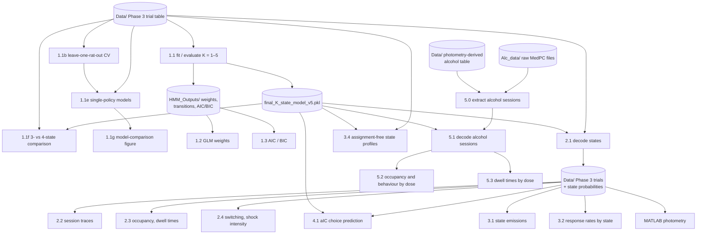

# Latent-state (GLM-HMM) analysis of approach–avoidance conflict

Python analysis code for:

> Marchant NJ, Pieterse NHJ, Sonsini G, McDonald AJ, van Mourik Y, Schetters D, De Vries TJ (2026). **Latent state selection, not outcome integration, resolves approach–avoidance conflict.** *TODO: journal.* TODO: DOI

Rats were trained on an operant task in which a lever press after a reward cue (rewDS) delivered a food pellet, a press after a punishment cue (punDS) delivered a footshock, and a press after a conflict cue (both cues together) delivered one or the other with equal probability. This repository fits a Bernoulli GLM-HMM to trial-by-trial press/omit choices in the conflict phase (Phase 3), selects the number of latent states, assigns trials to states, characterises the states and how rats move between them, tests whether cue-period anterior insular cortex (aIC) activity predicts choice beyond the model, and decodes the same states in sessions run after acute alcohol.

Three states were retained: **Risk-taking** (conflict treated predominantly as a reward trial), **Risk-averse** (conflict treated as a punishment trial) and **Repeating** (cue-independent repetition of the previous choice).

**Not in this repository:** fibre-photometry pre-processing and trace statistics (MATLAB; [njmarchant/Photom-Anterior_Insula_Conflict](https://github.com/njmarchant/Photom-Anterior_Insula_Conflict)), and the repeated-measures ANOVAs and mixed-effects models run in GraphPad Prism (10.6.0) on the per-rat tables these scripts export.

---

## The model

On trial *t* the rat presses (*y* = 1) or omits (*y* = 0). A hidden state *z*<sub>t</sub> ∈ {1, …, K} follows a first-order Markov chain, and within state *k* choice follows a logistic GLM:

$$p(y_t = 1 \mid x_t, z_t = k) = \sigma(w_k^\top x_t), \qquad x_t = [\text{rewDS}_t,\ \text{punDS}_t,\ \text{pellet}_{t-1},\ \text{shock}_{t-1},\ 1]$$

| Input | Coding |
|---|---|
| rewDS | 1 on reward and conflict trials, else 0 |
| punDS | 1 on punishment and conflict trials, else 0 |
| Past pellet | 1 if the previous trial *in the same session* ended in a pellet |
| Past shock | 1 if the previous trial *in the same session* ended in a shock |
| Bias | constant 1 |

Conflict is not a separate regressor: it is the trial type on which both cue indicators are on. History inputs are 0 on the first trial of each session and after an omission. Because every press produced an outcome, past pellet + past shock equals "pressed on the previous trial", so large, same-signed weights on both (the Repeating state) indicate choice perseveration rather than outcome-specific learning.

Models are fitted with [`ssm`](https://github.com/lindermanlab/ssm) (`observations="input_driven_obs"`, `C=2`; `transitions="standard"`). Each Rat × Session is an independent sequence; sessions with fewer than 5 trials are excluded. K = 1–5 states are fitted by EM (200 iterations, tolerance 1e-4) from 10 random initialisations each, keeping the solution with the highest final log-probability. The GLM weights have `ssm`'s weak N(0, 1000²) prior; transitions have none. All 16 rats of the operant cohort are pooled (233 sessions, 23,126 trials).

### Retained 3-state model (`final_3_state_model_v5.pkl`)

Weights are oriented so that positive values drive pressing.

| State | rewDS | punDS | Past pellet | Past shock | Bias |
|---|---:|---:|---:|---:|---:|
| 1 — Risk-taking | +2.92 | −1.98 | +0.26 | −0.18 | −0.26 |
| 2 — Risk-averse | +0.44 | −5.27 | +0.30 | +1.17 | +2.51 |
| 3 — Repeating | +0.10 | +0.35 | +10.04 | +7.31 | −5.32 |

| Transition (row → column) | → 1 | → 2 | → 3 |
|---|---:|---:|---:|
| from 1 | 0.947 | 0.008 | 0.044 |
| from 2 | 0.010 | 0.978 | 0.012 |
| from 3 | 0.064 | 0.020 | 0.915 |

---

## Pipeline overview



### Scripts behind the paper

| Step | Script | Purpose | Paper |
|---|---|---|---|
| 1 | `1.1_model_fit.py` | Fit (or evaluate the shipped) K = 1–5; export weights, transitions, AIC/BIC | Fig. 3A–C, S2C–D |
| 2 | `1.1b_cross_validation.py` | Leave-one-rat-out CV; 3-state model vs single-state GLM | Fig. S2A–B |
| 3 | `1.1f_four_state_comparison.py` | 3- vs 4-state solution: weight similarity, trial assignments, weights, behaviour | Fig. S2E–H |
| 3b | `1.1e_alternative_model_comparison.py` | GLM-HMM vs single-policy models (fixed, learning, drift): held-out prediction and simulation tests | Fig. X, Supp. Table X |
| 3c | `1.1g_plot_model_comparison_figure.py` | Model-comparison figure from the 1.1b / 1.1e outputs | Fig. X |
| 4 | `1.2_GLM_wts.py` | Per-state GLM weights | Fig. 3B |
| 5 | `1.3_model_selection_metrics.py` | Log-likelihood, AIC, BIC against K | Fig. S2C–D |
| 6 | `2.1_States_to_trials.py` | Smoothed state probabilities and labels for every trial | used by all below |
| 7 | `2.2_behav_HMMState_session_ALL.py` | One figure per session: posteriors, cues, choices, states | Fig. 3F |
| 8 | `2.3_plot_occupancy_and_dwell_times.py` | Occupancy per rat; run lengths | Fig. S3A–B |
| 9 | `2.4_state_dynamics_shock.py` | Within-session switching; occupancy vs training and shock intensity | Fig. S3C–G |
| 10 | `3.1_plot_state_emissions.py` | Per-rat response profile of each state | Fig. 3D |
| 11 | `3.2_plot_behavioral_metrics.py` | Response rate by state × cue; table for Prism | Fig. 3E |
| 12 | `3.4_predictive_posterior_state_profiles.py` | Model-implied press probabilities; profiles with non-circular state assignment | Results (Fig. 3 text) |
| 13 | `4.1_aIC_posthoc_choice_prediction.py` | Does aIC predict choice beyond the frozen model? | Fig. S4 |
| 14 | `5.0_extract_alcohol_sessions_from_medpc.py` | Build and validate the alcohol-test trial table from MedPC | Methods |
| 15 | `5.1_alcohol_states_to_trials.py` | Decode the alcohol sessions with the frozen model | used by 5.2, 5.3 |
| 16 | `5.2_alcohol_state_occupancy.py` | Behaviour and occupancy by dose and epoch; tables for Prism | Fig. 5A–B, S5A–B |
| 17 | `5.3_alcohol_dwell_times.py` | Dwell times by dose and epoch | Fig. S5C–D |

Steps 14–17 are run together by `bash run_alcohol_stage.sh`, which passes every file path explicitly, refuses to run if a script is an older copy, and saves each step's console output in `HMM_Outputs/Alcohol_logs/`.

### Additional analyses (not reported in the paper)

| Script | Purpose |
|---|---|
| `1.1c_state_count_diagnostics.py` | Occupancy and weight similarity of the extra states of the 4- and 5-state models |
| `1.1d_plot_cosine_similarity.py` | Heatmaps of the 1.1c cosine matrices |
| `5.4_alcohol_frozen_model_checks.py` | Does alcohol change occupancy or the policy within a state? Frozen-model fit by dose and dose-specific refits (`bash run_alcohol_stage.sh --checks`) |

---

## Repository layout

```
.
├── 1.1_model_fit.py … 5.4_alcohol_frozen_model_checks.py
├── run_alcohol_stage.sh
├── conditions_from_lab_journal.csv        # dose per rat and alcohol-test date (from the injection record)
├── final_{1..5}_state_model_v5.pkl        # fitted models
├── requirements.txt                     # main environment
├── requirements_altmodels.txt           # environment for 1.1e
├── LICENSE.txt
├── Data/
│   ├── collated_2026_conflict_data_raw.csv                                         # Phase 3 input
│   ├── collated_2026_conflict_data_with_Probabilities_065_Past_PelletShock_v5.csv  # written by 2.1
│   ├── Conflict_02_Alc_tests_UPDATED_v2.csv                                        # photometry-derived alcohol table (input to 5.0)
│   ├── collated_2026_conflict_alcohol_raw.csv                                      # written by 5.0
│   └── collated_2026_conflict_alcohol_with_Probabilities_065.csv                   # written by 5.1
├── Alc_data/                               # raw MedPC files of the alcohol tests, one folder per test day
├── Session_Traces_Library_065/             # 2.2
└── HMM_Outputs/                            # all tables and figures
    ├── FourState/ (1.1f)   ├── StateDynamics/ (2.4)   ├── Emissions/ (3.1)   ├── 3.4_predictive_posteriors/ (3.4)
    ├── aIC_PostHoc/ (4.1)  ├── Alcohol_extract/ (5.0) ├── Alcohol_n15/ (5.2, 5.3; primary)   ├── Alcohol_n13/ (5.2, sensitivity)
    ├── Alcohol_checks/ (5.4)   └── Alcohol_logs/
```

All scripts run from the repository root (`python 2.1_States_to_trials.py`). Parameters sit in a configuration block at the top of each file; 1.1b, 1.1e, 4.1 and the alcohol scripts also take command-line options (`--help`). Figures are saved as SVG (editable text) and PNG or PDF; no script opens a window.

---

## Installation

The published analyses were run with Python 3.11.15 and `ssm` commit `eb6c8aa33e5311d3564075807dec340759dd8081`; `requirements.txt` lists the package versions of that environment. The scripts were also tested with Python 3.13 and pandas 2.3 and 3.0. `ssm` is not on PyPI and is installed from GitHub at a pinned commit. It compiles Cython extensions, so NumPy, Cython and setuptools must be installed first.

```bash
conda create -n aic-glmhmm python=3.11
conda activate aic-glmhmm
pip install numpy cython setuptools wheel
git clone https://github.com/lindermanlab/ssm.git
cd ssm && git checkout eb6c8aa33e5311d3564075807dec340759dd8081 && pip install --no-build-isolation -e . && cd ..
pip install -r requirements.txt
```

**1.1e uses its own environment.** `1.1e_alternative_model_comparison.py` does not need `ssm` and was run in a separate environment with jax 0.10.2 (`requirements_altmodels.txt`), because jax 0.10.0 in the main environment crashed with a segmentation fault:
```bash
conda create -n altmodels python=3.11
conda activate altmodels
pip install -r requirements_altmodels.txt
python 1.1e_alternative_model_comparison.py
```

**Troubleshooting.**

- *"A module that was compiled using NumPy 1.x cannot be run in NumPy 2.x"* (or `_ARRAY_API not found`) when `ssm` is imported: `ssm` was built against a different NumPy than the one now installed, usually because NumPy was upgraded afterwards. Rebuild `ssm` in the active environment; this leaves NumPy and the other packages unchanged:
  ```bash
  pip install cython setuptools wheel
  pip install --no-deps --force-reinstall --no-build-isolation \
      "git+https://github.com/lindermanlab/ssm.git@eb6c8aa33e5311d3564075807dec340759dd8081"
  ```
  Do not downgrade NumPy instead: the model files saved under NumPy 2 do not load under NumPy 1.
- *Windows:* `ssm` compiles C extensions and is easiest to use under Linux or WSL; the pipeline was run under WSL. If a script stops on Windows without an error message, run it with `python -X faulthandler <script>` to see where.

The model files are pickled `ssm` objects and load only with a compatible `ssm` version. `3.1` uses plotly for Fig. 3D (and trimesh, optionally, for a PowerPoint 3D model); `1.1e` needs `jax` (see below).

---

## Input data

Trial-level data are in `Data/` and `Alc_data/` (see the data-availability statement in the paper).

**Phase 3 trial table** (`Data/collated_2026_conflict_data_raw.csv`), one row per trial:

| Column | Content | Used by |
|---|---|---|
| `Rat` | Animal ID (`R09` … `R24`) | all |
| `Session` | Session label, unique within rat (e.g. `3.03`; read as text) | all |
| `Trial` | Trial number within session; defines order | all |
| `Cue` | `reward`, `punish` or `conflict` | all |
| `Outcome` | 1 = lever press, 0 = omission | all |
| `Response` | `Response-Pellet`, `Response-Shock` or `Omission` | model scripts |
| `Intensity` | Footshock intensity for the session (mA) | 2.4 |
| `Latency` | Response latency from lever insertion (s) | 3.2 |
| `ZMean_BL`, `ZMean_CueFull` | Mean z-ΔF/F before trial onset and over the 10-s cue (MATLAB) | 4.1 |

**Alcohol tests.** `5.0` reads the raw MedPC files in `Alc_data/` (one `Subject_R##_Experiment_7_Group_0.txt` per rat and day) and the photometry-derived trial table. A MedPC file holds, per trial, the cue, press or omission, latency from cue onset and trial end time, plus a list of magazine entries; it does not hold the drug condition or which outcome a conflict press produced. Doses come from `conditions_from_lab_journal.csv` (`Rat`, `Date`, `Session_Type` = `Saline` / `Alcohol_Low` / `Alcohol_High` / `EXCLUDE`). The table written by `5.0` has `Rat`, `Session_Type`, `Session_ID`, `Date`, `Trial`, `Timestamp` (s from recording start), `Cue`, `Response`, `Outcome`, `Latency`, the photometry columns, and provenance columns (`Response_Source`, `Timestamp_Source`, `Condition_Source`, `Table_Status`, `Table_Row_Used`).

---

## Script reference

### Stage 1 — Fitting and model selection

**`1.1_model_fit.py`** builds the inputs and, with `REFIT_MODELS = False` (default), evaluates the shipped model files without refitting; with `"missing"` it fits only the K for which no model file exists; with `True` it refits K = 1–5 by multi-start EM and saves every K, never overwriting an existing model file unless `OVERWRITE_MODELS = True`. AIC and BIC use the data log-likelihood (`hmm.log_likelihood`, without `ssm`'s weight prior), n = number of trials and K² − 1 + 5K free parameters. Writes, in `HMM_Outputs/`, `Model_Selection_Metrics.csv`, `Model_Selection_AIC_BIC`, `3_State_GLM_Weights.csv` and `3_State_Transitions.csv`.

**`1.1b_cross_validation.py`** refits every K on 15 rats and scores the held-out rat with a scaled forward filter (16 folds × 5 K × 10 initialisations = 800 fits; the slowest step). It reports held-out log-likelihood per trial and one-step-ahead choice accuracy, in which the state distribution at trial *t* is the filtered posterior from *t* − 1 propagated through the transition matrix, so no prediction is conditioned on the choice it predicts. A single-state logistic regression on the same training rats is the per-cue baseline. Because each fold is scored with its own model, the metrics do not depend on state numbering. Writes `CV_HeldOut_LL_by_State.csv`, `CV_OneStepAhead_Accuracy.csv`, `SuppFig2_stats.txt` (legend-ready statistics) and `SuppFig_CrossValidation_{Accuracy,AccuracyByState,LL}` (Fig. S2A, S2B, not shown). `--stats-only` redoes the statistics and figures from the saved CSVs.

**`1.1f_four_state_comparison.py`** compares the retained 3-state model with the saved 4-state solution on the full dataset (no refitting): cosine similarity of the GLM weight vectors with optimal state matching (S2E), cross-tabulated trial assignments at the 0.65 threshold as row percentages (S2F), the 4-state weights selected by input name (S2G), and per-rat percentages of trials completed by state and cue (S2H), exported for Prism. Writes to `HMM_Outputs/FourState/`.

**`1.1e_alternative_model_comparison.py`** compares the GLM-HMM with models in which a single policy produces choice, each using the same five inputs: a fixed logistic GLM; Q-learning with a Pavlovian bias (elemental or configural cue values, fitted to all rats or per rat with shrinkage towards the population fit and cross-validated across that rat's sessions); dynamic GLMs whose weights drift by a random walk or a mean-reverting AR(1) process, reset each session or carried over; and per-session / per-rat static GLMs as controls. All are scored by the same causal held-out log-likelihood as the GLM-HMM in 1.1b (leave-one-rat-out; 1.1b's results are read, not refitted). `--ppc` simulates each fitted model 50 times on the rats' own trial sequences and compares the persistence of conflict responding (blocks of eight conflict trials with ≥ 6 or ≤ 2 presses) and the within-session coupling of conflict with rewDS and punDS responding. New runs are merged into the saved results. Writes the `AltModels_*` tables, `AltModels_stats.txt` (Supp. Table X values) and supplementary figures to `HMM_Outputs/`. It runs in its own environment (see Installation).

**`1.1g_plot_model_comparison_figure.py`** draws Fig. X from the 1.1b and 1.1e outputs, one model per account (fixed: GLM static; learning: configural Q-learning + Pavlovian, per rat; drift: random walk reset each session; states: the 3-state GLM-HMM). Writes `HMM_Outputs/Fig_ModelComparison` and `Fig_ModelComparison_values.csv` (every plotted number).

**`1.2_GLM_wts.py`** plots the weights from `3_State_GLM_Weights.csv`, selecting each input by column name, and refuses the legacy hand-edited file whose history columns were transposed. Writes `HMM_Outputs/Fig_GLM_Weights` (Fig. 3B).

**`1.3_model_selection_metrics.py`** plots log-likelihood, AIC and BIC against K. Writes `HMM_Outputs/SuppFig_Model_Selection` (Fig. S2C–D).

### Stage 2 — State decoding and dynamics (Phase 3)

**`2.1_States_to_trials.py`** runs the frozen model over every session with `hmm.expected_states` (forward–backward smoothing) and adds `Prob_State_1`–`3`, `State_Confidence` and `Inferred_State` (most probable state if its probability is at least 0.65, otherwise empty). Writes the Phase 3 trial table with state probabilities to `Data/`, refusing to overwrite an existing table that holds columns it does not produce; it is the input to all later Phase 3 scripts and to the state-sorted photometry analyses in MATLAB.

**`2.2_behav_HMMState_session_ALL.py`** draws one figure per session: state posteriors across trials (top) and trial type, choice and assigned state (bottom). Writes `Session_Traces_Library_065/` (PNG); sessions listed in `ONLY_SESSIONS` (R13, sessions 3.03 and 3.10, as in Fig. 3F) are also saved as SVG.

**`2.3_plot_occupancy_and_dwell_times.py`** computes each rat's occupancy (percentage of its assigned trials in each state) and the run lengths of each state (definition under *Shared definitions*), and reports how runs end. Writes `HMM_Outputs/SuppFig_Occupancy_Dwell_gap3` (Fig. S3A–B), `occupancy_per_rat.csv` and `dwell_runs_gap3.csv`.

**`2.4_state_dynamics_shock.py`** counts state switches per session and their types (direct Risk-taking ↔ Risk-averse vs. via Repeating), repeats the count with minimum run lengths of 1, 3, 5 and 10 trials, decomposes trial-level state membership into between-rat, between-session and within-session sums of squares, and models session occupancy with random-intercept linear mixed models (`occupancy ~ session`; `occupancy ~ intensity_within + intensity_between + session`, per 0.05 mA; and a session-to-session change model). Writes to `HMM_Outputs/StateDynamics/`, including `SUMMARY.txt` (the Results numbers) and `Fig_StateDynamics` (Fig. S3C–G).

### Stage 3 — Behavioural profile of the states

**`3.1_plot_state_emissions.py`** computes, for each rat and state, the probability of pressing on rewDS, punDS and conflict trials (assigned trials only) and the probability of repeating the previous choice of the session, and draws 2D, pairwise and 3D views. Writes to `HMM_Outputs/Emissions/`; `interactive_3d_states.html` is the source of Fig. 3D and `state_emissions_per_rat.csv` holds the values.

**`3.2_plot_behavioral_metrics.py`** computes per-rat response rates (and latencies on pressed trials) for each state × cue and exports the complete grid, with trial counts, as `HMM_Outputs/summary_statistics_by_rat_state_cue.csv`, the input to the State × Cue ANOVA in Prism. Writes `HMM_Outputs/Fig3E_Response_Rate_Bar` (Fig. 3E) and `Latency_by_State_Bar` (not in the paper).

**`3.4_predictive_posterior_state_profiles.py`** computes, for every Phase 3 trial, the smoothed, one-step-ahead and leave-current-choice-out state posteriors, recomputes the Fig. 3E profiles with each, and tabulates the model-implied probability of pressing by state, cue and previous outcome (`emission_table.csv`: the source of the Results values 0.62–0.72 and 0.09–0.24 for conflict trials, and 0.99 / 0.89 / 0.005 for the Repeating state). Writes to `HMM_Outputs/3.4_predictive_posteriors/`.

### Stage 4 — aIC activity and choice

**`4.1_aIC_posthoc_choice_prediction.py`** holds the 3-state model fixed, runs it causally to obtain each trial's one-step-ahead probability of pressing and one-step-ahead state probabilities, and enters the log-odds of that prediction as a fixed offset in a second-stage logistic regression to which within-session z-scored cue-period aIC activity is added (models: offset only; one aIC slope; slopes per cue; per state; conflict slope by state; slope per cue × state). Evaluation: leave-one-rat-out cross-validation on the 14 photometry rats (R18 and R21 excluded); a null with aIC shuffled within Rat × Session × Cue; full-data fits with rat-clustered standard errors; Wald contrasts between states and between cues within state; a null with state probabilities shuffled among conflict trials within session; and the same analyses for pre-trial activity as a control (1,000 permutations each, `--n-perm`; odds ratios in the paper are exp(β)). Writes to `HMM_Outputs/aIC_PostHoc/`: `aIC_PostHoc_Window_BL_vs_CueFull` (S4A), `aIC_SlopeGrid_CueByState_ZMean_CueFull` (S4B), `aIC_SlopeMatching_WithinState_ZMean_CueFull` (S4C–D) and the supporting tables.

### Stage 5 — Alcohol tests

**`5.0_extract_alcohol_sessions_from_medpc.py`** builds the alcohol-test trial table from the raw MedPC files and reconciles each session with the photometry-derived table, matching trials on cue, press and latency. Agreeing trials keep that table's outcome, timing and photometry values; a spurious extra table row is removed and the rest renumbered; single disagreeing trials take the MedPC values and lose their photometry value; sessions absent from the table (here R23's two saline sessions and R12's second 0.5 g/kg session) are restored from MedPC, with doses from `conditions_from_lab_journal.csv`, conflict outcomes inferred from magazine entries (a pellet is followed by an entry 0.25–3.0 s after the press; 89.5% correct in leave-one-rat-out testing on 1,565 conflict presses with known outcome) and trial times from the median MedPC-to-photometry clock offset. Every row carries its provenance. Writes `Data/collated_2026_conflict_alcohol_raw.csv` and, in `HMM_Outputs/Alcohol_extract/`, `validation_vs_matlab_table.csv`, `trial_discrepancies.csv`, `mag_calibration_presses.csv`, `session_inventory.csv` and `excluded_sessions.csv`.

**`5.1_alcohol_states_to_trials.py`** checks the input (cue and response labels, pellet/shock exactly when pressed, unique session IDs) and decodes every full session with the frozen model, as `2.1` does. Writes `Data/collated_2026_conflict_alcohol_with_Probabilities_065.csv`.

**`5.2_alcohol_state_occupancy.py`** splits each session at 900 s, computes per rat and dose the occupancy (percentage of assigned trials, sessions pooled) and press rates by cue for both epochs, and exports wide tables for Prism (`occupancy_wide_*`, `behaviour_wide_*`), a nonparametric cross-check (`dose_tests.csv`), `SUMMARY.txt` and the occupancy figures (Fig. 5B, S5B). Rats without all three doses are dropped; `--exclude` sets the analysed rats.

**`5.3_alcohol_dwell_times.py`** computes run lengths with the Phase 3 definition, separately within each epoch so that no run crosses the 900 s boundary (runs touching it are flagged as censored), and exports per-run and per-rat tables, rat-level median and mean run lengths for Prism, pooled summaries, a mixed-model cross-check and `Fig_S5CD_DwellTimes` (Fig. S5C–D).

---

## Shared definitions

**Sign convention.** `ssm`'s input-driven observation model fixes the logit of the last class to zero, so `hmm.observations.Wk` are log-odds of omission relative to press. Every script multiplies them by −1, so positive weights drive pressing.

**Two kinds of state posterior.** Smoothed posteriors use the whole session, including the choice on the trial being labelled; one-step-ahead posteriors use only earlier choices.

| Analysis | Posterior | Scripts |
|---|---|---|
| State labels, occupancy, dwell times, switching, response rates by state, state-sorted photometry, alcohol decoding | Smoothed, p(z<sub>t</sub> \| y<sub>1:T</sub>) | 2.1 → 2.2, 2.3, 2.4, 3.1, 3.2, MATLAB; 5.1 → 5.2, 5.3 |
| Held-out log-likelihood and choice accuracy | One-step-ahead, p(z<sub>t</sub> \| y<sub>1:t−1</sub>) | 1.1b, 1.1e |
| Model prediction and state weights in the aIC analysis | One-step-ahead | 4.1 |
| Assignment-free and non-circular state profiles | All three | 3.4 |

Because smoothed posteriors use the labelled trial's own choice, response rates by state (Fig. 3D–E) describe the states rather than validate them independently; the cross-validated tests are in `1.1b`, and `3.4` repeats the profiles without the current choice.

**Assignment threshold.** A trial is assigned to its most probable state if that probability is at least 0.65 (chance 0.33); otherwise it is unassigned. Occupancy is a percentage of assigned trials.

**Runs and dwell times** (`2.3`, `2.4`, `5.3`). Within a session, assigned trials form runs of the same state. A run may bridge up to 3 consecutive unassigned trials if the same state resumes on both sides; bridged trials count towards its length. A run ends when a different state is assigned, after more than 3 consecutive unassigned trials, or at the end of the trial sequence; runs ending at a session or epoch boundary are censored. A switch (`2.4`) is counted between consecutive runs of different states that are each at least 3 trials long.

**Alcohol epochs.** Sessions are decoded in full, then split by trial start time at 900 s; the first 15 minutes are analysed separately (Fig. S5).

**Rats.** Phase 3 model and behaviour: 16 rats. Photometry analyses: 14 (R18 and R21 excluded after histology). Alcohol behaviour and states: 15 (R09 left the cohort before the tests); alcohol photometry: 13.

**State numbering.** HMM state indices depend on initialisation. The labels 1 = Risk-taking, 2 = Risk-averse, 3 = Repeating were assigned from the fitted weights and are hard-coded downstream. If you refit, compare the weights with the table above and reorder the states before Stage 2, e.g. `hmm.permute(np.array([1, 2, 0]))` puts old state 2 first, old state 3 second and old state 1 third. To reproduce the published numbers, use the shipped model files.

**Reproducibility.** `np.random.seed(14)` is set before fitting (`1.1`, `1.1b`, `1.1e`); `4.1` and the alcohol scripts use `np.random.default_rng(14)`. Identical refits also require the pinned `ssm` commit and the package versions in `requirements.txt`.

---

## Checking a re-run against the paper

| Quantity | Script | Value in the paper |
|---|---|---|
| Phase 3 sessions / trials | 1.1, 2.1 (console) | 233 sessions, 23,126 trials, 16 rats |
| Trials unassigned at 0.65 | 2.1 | 2,731 (11.8%) |
| Held-out accuracy, 1 → 3 states | 1.1b | 77.0 ± 0.9% → 83.1 ± 1.0% |
| Conflict-trial accuracy, 3-state vs GLM | 1.1b | 74.7 ± 1.9% vs 65.6 ± 1.4%; 16/16 rats |
| 3- vs 4-state weight cosine (Risk-taking, Risk-averse, Repeating; extra state to Risk-averse) | 1.1f | 0.997, 0.999, 0.721; 0.929 |
| Repeating trials reassigned to Repeating 1 / Repeating 2 | 1.1f | 70.6% / 27.0% |
| Model-implied p(press), Repeating state, after pellet / shock / omission | 3.4 | 0.99 / 0.89 / 0.005 |
| Median run length, states 1 / 2 / 3 | 2.3 | 11 / 25.5 / 8 trials |
| Sessions with ≥ 1 switch; direct / via-Repeating on-task changes | 2.4 | 76.4%; 83 / 45 |
| Alcohol table: sessions / trials / rats | 5.0 | 89 / 8,900 / 15 |
| MedPC vs photometry table agreement | 5.0 | 8,598 of 8,600 trials |
| Alcohol trials unassigned at 0.65 | 5.1 | 11.7% |

---

## Figure map

| Panel | Script | Output (in `HMM_Outputs/` unless stated) |
|---|---|---|
| Fig. 3A (transition values), 3C | 1.1 | `3_State_Transitions.csv` |
| Fig. 3B | 1.2 | `Fig_GLM_Weights` |
| Fig. 3D | 3.1 | `Emissions/interactive_3d_states.html` |
| Fig. 3E | 3.2 | `Fig3E_Response_Rate_Bar`; ANOVA in Prism on `summary_statistics_by_rat_state_cue.csv` |
| Fig. 3F | 2.2 | `Session_Traces_Library_065/Rat_R13_Session_3.03.svg`, `…3.10.svg` |
| Fig. 4, 5C–E, 6 | MATLAB | state labels from the 2.1 / 5.1 tables |
| Fig. 5A, S5A | 5.2 | `Alcohol_n15/behaviour_wide_*.csv` → Prism |
| Fig. 5B, S5B | 5.2 | `Alcohol_n15/Fig5B_…`, `FigS5B_…`; Prism on `occupancy_wide_*.csv` |
| Fig. X (model comparison) | 1.1g | `Fig_ModelComparison`; values in `Fig_ModelComparison_values.csv` |
| Supp. Table X | 1.1e | `AltModels_stats.txt` |
| Fig. S2A | 1.1b | `SuppFig_CrossValidation_Accuracy` |
| Fig. S2B | 1.1b | `SuppFig_CrossValidation_AccuracyByState` |
| Fig. S2C–D | 1.1 / 1.3 | `Model_Selection_Metrics.csv`, `SuppFig_Model_Selection` |
| Fig. S2E–H | 1.1f | `FourState/SuppFig2E…H` |
| Fig. S3A–B | 2.3 | `SuppFig_Occupancy_Dwell_gap3` |
| Fig. S3C–G | 2.4 | `StateDynamics/Fig_StateDynamics` |
| Fig. S4A–D | 4.1 | `aIC_PostHoc/` (see Stage 4) |
| Fig. S5C–D | 5.3 | `Alcohol_n15/Fig_S5CD_DwellTimes`; Prism on `dwell_median_wide_*.csv` |

---

## Citation

```bibtex
@article{marchant2026latent,
  title   = {Latent state selection, not outcome integration, resolves approach--avoidance conflict},
  author  = {Marchant, Nathan J. and Pieterse, Nathan H. J. and Sonsini, Gregorio and McDonald, Allison J. and van Mourik, Yvar and Schetters, Dustin and De Vries, Taco J.},
  journal = {TODO},
  year    = {2026},
  doi     = {TODO}
}
```

The GLM-HMM approach follows Escola et al. (2011), Bolkan et al. (2022) and Ashwood et al. (2022); please also cite `ssm` (Linderman lab).

## License

The code is released under the MIT License (see `LICENSE.txt`).

## Contact

Nathan J. Marchant — n.marchant@amsterdamumc.nl
